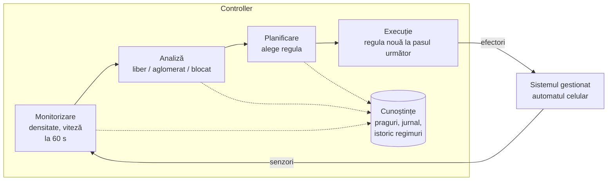

# Cum proiectați bucla MAPE-K

Bucla e partea care face proiectul „autoadaptiv” și valorează 20 de puncte. Merită gândită pe hârtie înainte de cod.

## Patru întrebări

1. **Ce măsurați și cât de des?** (M) Alegeți puține măsurători, legate direct de metrica principală. Intervalul trebuie să fie destul de lung ca măsurătoarea să nu fie zgomot și destul de scurt ca reacția să vină la timp.
2. **Ce stări distingeți?** (A) De obicei două-trei: „normal”, „degradat”, „critic”. Pentru fiecare, un criteriu concret (un prag, o comparație cu istoricul).
3. **Ce acțiuni are controllerul?** (P) O listă finită și mică: schimbă regula, crește mutația, comută pe ruta de rezervă, mută o cursă. Pentru fiecare stare, ce acțiune alegeți și de ce.
4. **Ce țineți minte?** (K) Ce e nevoie între două cicluri: ultima stare (pentru histerezis), configurațiile anterioare, rutele precalculate, jurnalul deciziilor.

## Capcane

- **Oscilații.** Dacă măsurătoarea stă în jurul pragului, controllerul schimbă decizia la fiecare ciclu. Remediu: praguri diferite la urcare și la coborâre (histerezis) sau cerința ca o stare să se mențină două cicluri la rând. Exemplul `examples/toy_mapek.py` folosește histerezis.
- **Controller care „trișează”.** Controllerul nu are voie să știe dinainte când apare perturbarea. El vede doar ce măsoară.
- **Adaptare invizibilă.** La demonstrație trebuie să se vadă decizia. Jurnalul (`Controller.log`) și o figură cu momentul deciziei rezolvă asta.

## Diagrama din raport

O diagramă clasică are cele patru blocuri în cerc, cu K în mijloc, iar sistemul gestionat dedesubt, legat prin senzori (spre M) și efectori (dinspre E). Pe fiecare bloc scrieți elementele concrete ale proiectului vostru. Un punct de pornire în Mermaid (se poate desena în https://mermaid.live și exporta ca SVG):

